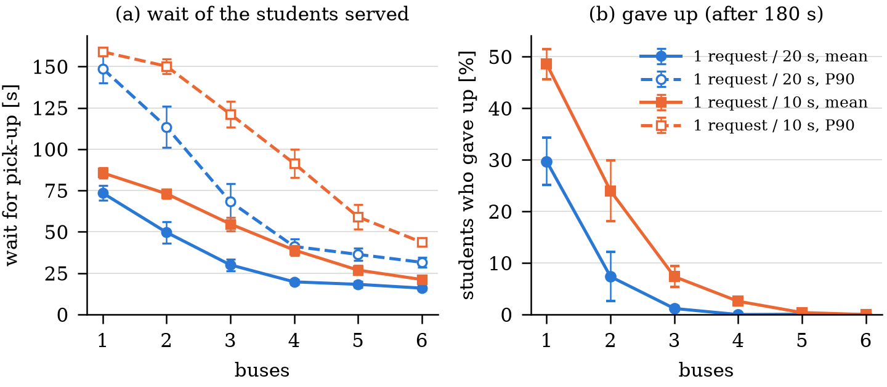

# Fleet-level results: service against fleet size

**Question.** The twin exists to run a fleet: campus shuttles that take students' ride requests. How does service change with the number of buses, when every bus drives on the physics Core, plans with the game's dispatcher and battery rules, and keeps out of the others' way by the traffic rules (ADR 0012)?

**Answer, in one line.** At the game's default demand (one request every 20 s), one bus is overwhelmed: 30 % of students give up and those served wait 74 s on average. Three buses (the game's default) serve all but 1.2 % of students, with a 30 s mean wait. From four buses no student gives up and the mean wait falls only slowly, from 20 s to 16 s at six. At twice the demand, six buses are needed to bring give-ups to zero. More buses cost energy per ride (about twice as much from four buses as with one, since they pool less and drive more empty) and bring more traffic interaction: give-way stops, stuck buses that had to be towed, and footprint overlaps. The traffic rules do not prevent overlaps. Nearly all overlaps happen at walking pace or at rest, but they happen.

**What this is not.** It is a simulation of one campus (the 36-node road network at 1/10 scale), with a provisional car: every vehicle parameter is SlipX's generic 1/10 car, not a measured one. The battery is a game battery that lasts five minutes of driving, the demand is a Poisson process weighted by stop, and the dispatcher, battery and traffic rules are the game's own. The numbers describe this twin under these rules, not a real shuttle service.

## Reproduce

About 85 minutes on 8 parallel workers (Ryzen 7 9700X). The player needs the plugin built first (README, step 3), and Unity closed:

```bash
python -m venv build/fleet/venv
build/fleet/venv/Scripts/python -m pip install numpy==2.5.4 matplotlib==3.11.2
.toolchain/venv/Scripts/cmake --build build --target unity_plugin
build/fleet/venv/Scripts/python tools/fleet_experiment.py build
build/fleet/venv/Scripts/python tools/fleet_experiment.py check
build/fleet/venv/Scripts/python tools/fleet_experiment.py run --workers 8
build/fleet/venv/Scripts/python tools/fleet_experiment.py analyse
```

Outputs:
- [`results/reference/fleet.json`](../results/reference/fleet.json): the protocol, a summary per configuration (mean, 95 % half-width and n for every metric, plus totals of the counts), and every run's own numbers.
- `results/reference/fleet_wait.{pdf,png}`: the figure, 122 mm wide for a single-column LNCS page.
- The raw runs are in `build/fleet/runs/` (not in git): each run's metrics JSON, with every request and leg, and its player log.

A seed gives the same metrics file every time and at any speed-up, so `analyse` reproduces `fleet.json` exactly apart from wall times and the commit.

## Method

**The real player, headless.** `tools/fleet_experiment.py build` builds the campus player from the committed scene (`CampusSceneBuilder.BuildPlayerAsIsBatch`). Each run starts it with `-batchmode -nographics` and these options, which leave the game's default behaviour unchanged when absent:

| Option | What it does |
|---|---|
| `-buses n` | fleet size (existing) |
| `-seed s` | the request generator's seed (default 1, as before) |
| `-request-interval t` | one request every t s across the campus (default 20 s, the game's) |
| `-duration T`, `-warmup W` | end the run at T s of game time; measure over (W, T] |
| `-fast k` | run k control ticks per frame, as fast as the machine allows |
| `-metrics file.json` | write what the run measured (`FleetMetrics`) when it ends |

**Fast-forward does not change the physics.** The fleet steps once per 10 ms control tick, and each tick steps the Core ten times at a fixed 1 ms, as at normal speed. `-fast` only changes how many ticks run per rendered frame (`Time.captureDeltaTime`). One thing in the game did depend on the wall clock: turn-rounds are planned on a background thread while the bus waits, braked. Fast-forwarded, that wait grew in game time, and turn-rounds of 60 s appeared. With `-fast` the plan is now made within the tick and used on the next one (`TwinAutopilot.PlanInline`, off by default). After that change, the same seed at 1, 20 and 50 ticks a frame, and twice at 20, gives identical metrics files apart from wall time (`check`). The interactive player still plans in the background, so its turns start after the planning time on the wall clock rather than one tick. That is the one difference between these runs and the game as played.

**Protocol.**
- Fleet sizes 1 to 6.
- Two demand levels: one request every 20 s (the default) and every 10 s.
- Seeds 1 to 10 for each, 120 runs in all.
- Each run lasts 4,500 s of game time. The first 600 s are a warm-up: the buses start with full batteries and the stops empty.
- Time-based metrics are over the window (600, 4,500] s, 65 min per run and 10.8 h per configuration. Requests are scored if raised in (600, 4,200] s, so each has 300 s to resolve (the give-up time is 180 s).
- Every game setting is the default: six seats, a 2 m/s cruise, 180 s before a student gives up, a battery of five minutes of driving, chargers at AB1 and AB3, and a 0.2 m lane offset.

**Metrics.**
- **Wait:** pick-up time minus request time, for students served. The mean, and the 90th percentile within each run.
- **Ride time:** drop-off time minus pick-up time.
- **Rides per hour:** drop-offs in the window.
- **Gave up:** the share of scored requests whose student left after 180 s.
- **Occupancy:** riders aboard, averaged over all bus time.
- **Charging share:** bus time spent charging.
- **Energy:** the charge each car drew from its pack while the physics stepped (charging and tows excluded), times the pack's capacity and voltage. Energy per ride is that total over the drop-offs.
- **Traffic:**
  - give-way stops: a bus held to a standstill by another;
  - the time held;
  - stuck tows: a bus held for 20 s is towed, so the rules did not resolve the hold;
  - overlaps: two bare footprints touching, counted per new contact.

Each table entry is the mean over the 10 seeds of the per-run value, with the half-width of a 95 % Student t interval. Counts are totals over the 10 runs.

## Results



*(a) Wait for pick-up of the students served: mean (filled) and 90th percentile (open). (b) Share of students who gave up. Means over 10 seeds with 95 % intervals.*

| Interval | Buses | Wait mean [s] | Wait P90 [s] | Ride [s] | Rides/h | Gave up [%] | Occupancy | Charging [%] | Wh/ride | Give-way stops/h | Stuck tows | Overlaps |
|---|---|---|---|---|---|---|---|---|---|---|---|---|
| 20 s | 1 | 73.5 ± 4.4 | 148.8 ± 8.6 | 39.7 ± 2.1 | 123.5 ± 7.3 | 29.7 ± 4.6 | 1.65 ± 0.30 | 14.0 ± 0.5 | 0.021 ± 0.002 | 0.0 ± 0.0 | 0 | 0 |
| 20 s | 2 | 49.7 ± 6.4 | 113.4 ± 12.4 | 35.2 ± 2.2 | 161.2 ± 13.5 | 7.4 ± 4.8 | 1.69 ± 0.25 | 13.1 ± 1.2 | 0.030 ± 0.003 | 41.3 ± 19.1 | 0 | 16 |
| 20 s | 3 | 30.0 ± 3.6 | 68.2 ± 11.0 | 30.1 ± 2.0 | 170.6 ± 10.7 | 1.2 ± 0.5 | 1.72 ± 0.59 | 11.7 ± 0.5 | 0.038 ± 0.002 | 101.2 ± 52.6 | 2 | 36 |
| 20 s | 4 | 19.8 ± 1.5 | 41.2 ± 4.5 | 26.3 ± 1.2 | 173.3 ± 10.9 | 0.0 ± 0.0 | 0.98 ± 0.21 | 9.2 ± 0.4 | 0.038 ± 0.002 | 248.7 ± 88.8 | 6 | 82 |
| 20 s | 5 | 18.3 ± 2.0 | 36.4 ± 3.7 | 25.7 ± 1.3 | 173.5 ± 10.1 | 0.1 ± 0.1 | 0.80 ± 0.20 | 7.3 ± 0.5 | 0.038 ± 0.001 | 294.5 ± 90.5 | 8 | 168 |
| 20 s | 6 | 16.0 ± 1.2 | 31.6 ± 2.9 | 25.1 ± 1.0 | 174.5 ± 10.3 | 0.0 ± 0.0 | 0.55 ± 0.19 | 6.2 ± 0.2 | 0.039 ± 0.002 | 370.6 ± 116.2 | 16 | 231 |
| 10 s | 1 | 85.7 ± 3.2 | 158.9 ± 2.3 | 52.2 ± 2.5 | 183.0 ± 6.9 | 48.6 ± 2.9 | 2.82 ± 0.24 | 12.6 ± 0.4 | 0.013 ± 0.001 | 0.0 ± 0.0 | 0 | 0 |
| 10 s | 2 | 73.1 ± 2.9 | 150.2 ± 4.4 | 45.6 ± 3.3 | 268.4 ± 23.4 | 24.0 ± 5.9 | 2.88 ± 0.57 | 12.8 ± 1.1 | 0.017 ± 0.001 | 69.5 ± 57.0 | 2 | 22 |
| 10 s | 3 | 54.8 ± 4.0 | 121.2 ± 7.8 | 41.6 ± 2.0 | 326.4 ± 10.5 | 7.4 ± 2.0 | 2.47 ± 0.37 | 13.8 ± 0.3 | 0.023 ± 0.001 | 222.4 ± 80.7 | 6 | 71 |
| 10 s | 4 | 39.0 ± 3.3 | 91.4 ± 8.5 | 36.7 ± 3.1 | 340.2 ± 13.9 | 2.6 ± 0.7 | 2.00 ± 0.36 | 13.1 ± 0.5 | 0.028 ± 0.002 | 315.5 ± 88.3 | 7 | 127 |
| 10 s | 5 | 26.9 ± 2.8 | 59.1 ± 7.5 | 31.2 ± 1.8 | 347.9 ± 14.7 | 0.4 ± 0.3 | 1.64 ± 0.30 | 11.7 ± 0.4 | 0.031 ± 0.001 | 421.2 ± 156.1 | 3 | 157 |
| 10 s | 6 | 21.2 ± 0.8 | 43.7 ± 2.2 | 29.1 ± 1.1 | 350.3 ± 15.7 | 0.0 ± 0.0 | 1.14 ± 0.18 | 10.1 ± 0.4 | 0.031 ± 0.001 | 596.8 ± 130.8 | 17 | 246 |

10 runs per row, 10.8 h of fleet operation per row. Scored requests: 1,770 per row at 20 s and 3,594 at 10 s.

### Service

- **Throughput follows demand once the fleet is large enough.** At the default rate the campus raises about 177 scored requests per hour. One bus delivers 124 an hour, and from three buses the fleet delivers 171 to 175. At twice the demand (about 360 an hour), throughput climbs from 183 with one bus to 350 with six.
- **Waits fall steeply up to about four buses, then slowly.** At the default rate the mean wait goes 73.5, 49.7, 30.0 and 19.8 s for one to four buses, then 18.3 and 16.0 s. The 90th percentile goes from 149 s to 41 s at four buses and 32 s at six. At twice the demand the fall is spread over the whole range, and six buses give a mean wait of 21 s and a 90th percentile of 44 s.
- **Waits are those of the students served.** When few buses serve many students, the longest waits end in a give-up instead and are not in the wait figures. With one bus at twice the demand, the 90th percentile (159 s) sits just under the 180 s give-up time, and half the students give up.
- **Rides get more direct with more buses.** A bus with fewer riders makes fewer stops on the way. Ride time over the direct drive time (route length at cruise speed, no stops) falls from 3.7 to 2.3 at the default rate, and from 5.0 to 2.8 at twice the demand. Even the most direct rides take over twice the direct time: starting, stopping, turn-rounds at stops and 3 s dwells all count.

### Fleet use and energy

- **Occupancy falls as the fleet grows.** At the default rate a bus carries on average 1.7 riders with one to three buses, and 0.55 with six. Idle time grows from under 1 % of bus time with one bus to 57 % with six. At twice the demand, buses stay fuller: 2.8 riders with one or two buses, 1.1 with six.
- **Charging takes 6 to 14 % of bus time.** It is highest when every bus drives all the time, and falls with fleet size as each bus drives less: 14.0 % with one bus to 6.2 % with six at the default rate. No bus ran its battery flat with fewer than three buses. With three to six buses there were 12 flats in 120 runs, 7 of them at five buses and twice the demand (`fleet.json`, `flats`).
- **Energy per ride grows with the fleet.** At the default rate, energy per ride goes from 0.021 Wh with one bus to 0.038 Wh from three buses, about 1.8 times as much, because riders pool less and buses drive more empty. Twice the demand pools better: 0.013 Wh per ride with one bus and 0.031 Wh with six. Energy per kilometre hardly changes: 0.76 to 0.83 Wh/km in every configuration, slightly more with more buses, which hold and turn more. The absolute figures are those of the provisional 1/10 car's model drawing from a game-sized pack. Their ratios carry the result, not their size.

### Traffic

- **Give-way stops grow faster than the fleet.** These are stops where a bus was held to a standstill by another. At the default rate there are 41 an hour with two buses and 371 an hour with six. The time a bus spends held grows from 29 s to 67 s per bus-hour, under 2 % of its time. At twice the demand: 70 to 597 stops an hour, and 30 to 90 s per bus-hour.
- **Stuck buses.** Twice the rules left a bus held for 20 s, so it was towed (ADR 0012's fallback). These are holds the rules did not resolve. There were none with two buses at the default rate, rising to 16 in 10.8 h with six (about 1.5 an hour). At twice the demand there were 2 to 17.
- **Overlaps happen.** The Core has no car-to-car contact, so two footprints that touch are only counted. The count rises from 16 in 10.8 h with two buses to 231 with six at the default rate, and to 246 at twice the demand. The player log records each one with every bus's pose and state, so the touching pair can be found. Of the 533 at the default rate, 474 (89 %) had both buses below 0.1 m/s, and 317 (59 %) had one of them turning round or lining up. In 40 (8 %) one bus was moving faster than 0.5 m/s. At twice the demand the shares are similar: 516 of 623 (83 %) at rest, 364 (58 %) turning, and 60 (10 %) faster than 0.5 m/s. Most centres were about one footprint length apart (median 0.42 m), so most are corners touching at a stop, not collisions on the road. The Play Mode fleet test expects none in its 300 s with three buses. Over hours, the rules let a few through, mostly where a bus turns round near another at a stop.
- **Deadlocks.** The rules break cycles of buses waiting on each other in favour of the lowest number (ADR 0012). `fleet.json` counts each change of who gives way that a cycle caused (`cycles_broken`): thousands per row. A cycle often forms again on the next tick and is broken the other way, so this counts flips, not distinct deadlocks. A cycle the rules failed to resolve shows up as a stuck tow.
- **Other incidents.** Kerb strikes: 0 to 40 per row, most at five and six buses and twice the demand. No leg failed for other reasons (`leg_fail_tows`, 0 in every run).

## Text for the paper

Use with the limits stated.

> We ran the campus shuttle game headless on the physics twin, with 1 to 6 buses, two demand levels and 10 seeds each (65 min of operation per run after a 10 min warm-up). At the default demand of one request every 20 s, one bus left 30 % of students to give up and made those served wait 74 s on average. Three buses served all but 1.2 %, with a 30 s mean wait, and from four buses no student gave up and the mean wait fell only from 20 s to 16 s at six. Larger fleets pooled less and used about 1.8 times the energy per ride, and gave way to each other more often: up to 371 standstills and 1.5 stuck-bus tows per hour with six buses. These results come from simulation of one campus at 1/10 scale, with a provisional car model and the game's own dispatch, battery and traffic rules. They show what the twin can evaluate, not how a real shuttle service performs.

## Limitations

- **Simulation only, one campus, a provisional car.** No parameter is measured, and the battery is sized for the game.
- **The game's own rules.** Cheapest-insertion dispatch with no reassignment, a 180 s give-up, and charging at the nearest free charger. A different dispatcher would give different numbers. The optional comparison of travel-time estimates (from edge length against from the twin's edge profiles) was not done here.
- **Fast-forward plans turns within a tick.** In the interactive player a turn starts once its plan arrives on the wall clock.
- **Overlaps are counted at first contact,** not by depth or duration. The touching pair is found from the logged poses (closest centres).
- **Stationary demand.** No timetable peaks: a Poisson process weighted by stop, the same in every hour.
