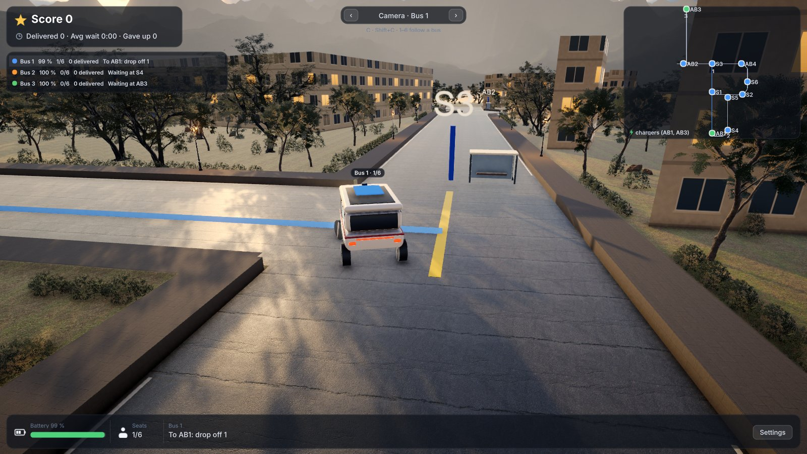
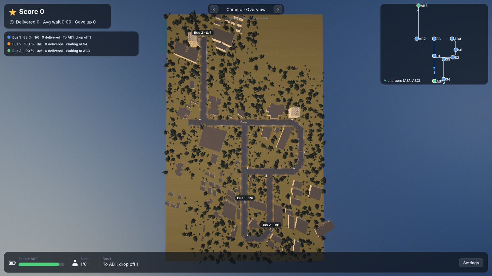

# rc-physics-twin

[](https://github.com/Sujay-197/rc-physics-twin/actions/workflows/ci.yml)
[](LICENSE)

A physics-first digital twin of a 1/10-scale electric RC car, driving a campus shuttle service in Unity. It simulates a double-track chassis at 1 kHz on a deterministic C++ core, follows roads with a tuned autopilot or a trained policy, and caches what each road costs for a fleet simulator.



> **Simulation only.** No parameter set here has been validated against a real car. Every one is labelled `provisional`, and the results below are results in simulation.

## What's in it

- **Vehicle dynamics.** Double-track chassis, load transfer, combined-slip tyres with relaxation, wheel spin, Ackermann steering, suspension, electric motor and battery, and a kinematic blend at walking pace. It is built on [SlipX](https://github.com/ibrahimsel/slipx), vendored in `core/` with the changes listed in [`THIRD_PARTY.md`](THIRD_PARTY.md). Runs are deterministic: CI checks them against reference hashes.
- **A C ABI, so any engine can host it.** `native/` wraps the core as `rc_twin.dll`. The Unity project is one host, and the Python tools are another.
- **Roads.** A road format with grade, banking, speed breakers and surface grip, and walls for kerbs and buildings.
- **A campus.** The road network of Amrita Vishwa Vidyapeetham, Coimbatore, at 1/10 scale, with buildings placed from OpenStreetMap.
- **An autopilot.** Route search, a hybrid A* planner for driven three-point turns, pure pursuit with a corner speed plan, and kerb recovery. On fresh simulated trips it finishes every stop-to-stop trip at 1 to 4 m/s, including with car parameters it was not tuned on.
- **Reinforcement learning.** A Gymnasium environment with domain randomisation, training scripts, and a [policy study](Docs/policy-study.md) comparing classical controllers with PPO, SAC and residual RL. No learned policy beat the tuned pure pursuit, and the study explains why.
- **A shuttle game.** Up to six buses serve students' ride requests, pool riders, charge themselves and give way to each other. See [`Docs/campus-player.md`](Docs/campus-player.md).
- **Edge profiles for fleet sims.** `tools/edge_profiler.py` drives the car over each road edge once and caches time and energy, so a fast fleet simulator can use them without running the physics.



## How it fits together

```
  Unity twin (unity/RcTwin)              Python (sim_py/, tools/)
  scenes, autopilot, shuttle game        RL environment, training, harness
             |                                       |
             +------------- rc_twin C ABI -----------+
                            (native/)
                                |
                     Core: vendored SlipX (core/)
                     C++17, deterministic, 1 kHz
                                |
                                v
              edge profiles (profiles/): time and energy per
              road edge, for a fleet sim such as campus_fleet_man_unity
```

## Getting started

Tested on Windows 11 only. CI builds on Windows, and the core has not been tried on other platforms from this repo.

You need Python 3.12 or newer and Git. No admin rights or Visual Studio are needed for the native build: the bootstrap installs Zig (Clang 21), CMake and Ninja into `.toolchain/`.

### 1. Build and test the native library

Run these from the repo root in Git Bash or PowerShell.

```bash
python tools/bootstrap_toolchain.py
```

```bash
.toolchain/venv/Scripts/cmake -S . -B build -G Ninja -DCMAKE_TOOLCHAIN_FILE="$PWD/.toolchain/zig-toolchain.cmake"
```

```bash
.toolchain/venv/Scripts/cmake --build build
```

```bash
.toolchain/venv/Scripts/ctest --test-dir build --output-on-failure
```

### 2. Try it without Unity

Drive a road headlessly and get a JSON report of time, energy and peak accelerations:

```bash
python tools/drive_road.py roads/samples/hill_breaker_bend.json --speed 2
```

The environments, controllers and evaluation are standard library only. Training needs `pip install -r sim_py/requirements-rl.txt`; see [`sim_py/README.md`](sim_py/README.md).

### 3. Run the Unity twin

You need [Unity](https://unity.com/download) **6000.5.3f1**.

1. Copy the plugin into the project, with the Unity editor closed (it keeps native plugins loaded):

   ```bash
   .toolchain/venv/Scripts/cmake --build build --target unity_plugin
   ```

2. Open `unity/RcTwin` in Unity Hub.
3. Run **RcTwin > Build Campus Scene** and press Play, or **RcTwin > Build Flat Ground Scene** for a test ground. On the flat ground, W/S is throttle and brake, A/D steers and R resets.
4. **RcTwin > Build Campus Player** builds `build/campus/RcTwinCampus.exe`, which starts the shuttle game. `-goto AB1 -speed 3` runs a single autopilot trip instead.

To build the player from the command line, leave out `-nographics`. Without graphics Unity skips the lighting setup, and the player comes out washed out.

```bash
"/c/Program Files/Unity/Hub/Editor/6000.5.3f1/Editor/Unity.exe" -batchmode -quit -projectPath unity/RcTwin -executeMethod RcTwin.EditorTools.CampusSceneBuilder.BuildPlayerBatch -logFile build/campus-player.log
```

### 4. Optional: the full look

A fresh clone has the campus with plain surfaces and no trees. The trees, textures, sky and models are CC0 assets that git doesn't carry, because they are large. To get them, you need [Blender](https://www.blender.org/download/) 5.2 and about 530 MB of downloads:

```bash
python tools/fetch_assets.py
```

```bash
blender -b --factory-startup --python tools/prepare_assets.py
```

Then rebuild the scene. The screenshots above show this look.

## Repository layout

| Path | What's there |
|---|---|
| `core/` | SlipX, vendored at `ebdbf3f` with our changes (`THIRD_PARTY.md`) |
| `native/` | `rc_twin`: the C ABI over the core, with C, C++ and C# tests |
| `unity/RcTwin/` | Unity project: bindings, autopilot, scene builders, shuttle game |
| `sim_py/` | RL environment, controllers, training and evaluation |
| `tools/` | Toolchain bootstrap, driving harness, edge profiler, campus and asset pipelines |
| `campus/` | The campus network, OpenStreetMap extract and scenery |
| `roads/`, `cars/`, `profiles/` | Road format and samples, car parameters, edge profile format and cache |
| `policies/` | Trained policy metrics, tuned gains, and the release policy (`policies/release/`) |
| `conformance/` | Reference hashes for the determinism check |
| `Docs/` | Design notes, decision records and the study |

## Documentation

- [The campus player](Docs/campus-player.md): the autopilot, shuttle game, cameras, look and replay player
- [Policy study](Docs/policy-study.md): every controller and policy compared, with methods and results
- [Roadmap](Docs/NEXT_STEPS.md): what's done and what's open
- [Architecture decision records](Docs/adr/) and [design specs](Docs/specs/)
- [Glossary](CONTEXT.md) and [references](Docs/references.md)
- Components: [`sim_py`](sim_py/README.md), [`campus`](campus/README.md), [`cars`](cars/README.md)

## Contributing

Issues and pull requests are welcome. [`CONTRIBUTING.md`](CONTRIBUTING.md) covers the tests to run and the rules for the core and for parameters.

## License

The code is under the [Apache License 2.0](LICENSE), with attributions in [`NOTICE`](NOTICE).

Not everything in the repo is under that licence:

- **Map data.** `campus/osm/amrita.osm.json`, `campus/scenery.json` and the scenery meshes derived from them are under the [Open Database License 1.0](https://www.openstreetmap.org/copyright). Map data © OpenStreetMap contributors.
- **SlipX** (`core/`) is Apache-2.0, with its own `LICENSE` and `NOTICE`.
- **Downloaded assets.** Poly Haven models and textures are CC0, and the Inter font is SIL OFL 1.1. They aren't in git, but a built player contains them.

[`THIRD_PARTY.md`](THIRD_PARTY.md) has the details.

## Honesty policy

No parameter set in this repo is claimed as validated unless it carries a `measured` or `identified` provenance label with a validation report. Today every set is `provisional`.
